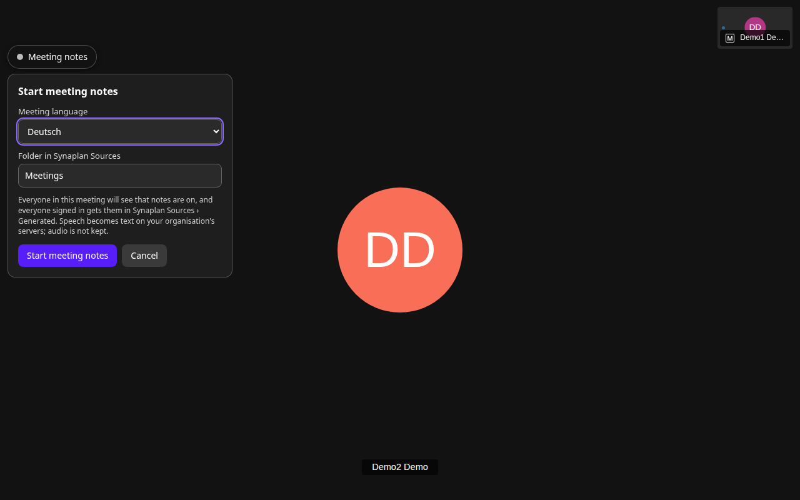
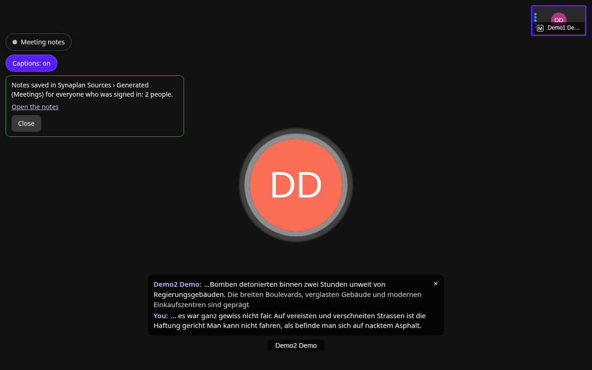

# Meeting notes for your openDesk — install guide

You run [openDesk](https://www.opendesk.eu) and it works. This folder adds
**meeting notes for Jitsi** to it, with one command:

- **Synaplan** (the AI server that keeps the notes) is installed next to
  openDesk and signs people in with their openDesk account.
- Every Jitsi meeting gets a **Meeting notes** button. Live captions show
  who said what, and after the meeting every signed-in participant finds
  the transcript in Synaplan › Sources › Generated.
- Speech becomes text on **your** servers. Audio is never stored.

| Start in the meeting | After the meeting |
|---|---|
|  |  |

Tested on openDesk **v1.19.1** (Jitsi chart 3.12.4) with Synaplan **5.3.2**.
Older openDesk releases (Jitsi chart before 3.12) get Jicofo's settings
through a start script instead; that path is rendered and unit-tested, but
not yet walked end to end.

---

## 1. Before you start

Tick every line; the installer checks them again.

- [ ] **openDesk works**: you can sign in at `https://portal.<your domain>` and
      start a Jitsi meeting.
- [ ] **kubectl** reaches the cluster with admin rights (`kubectl get nodes`
      works).
- [ ] The **tools openDesk needs** are installed: Helm 3 (3.17 or newer,
      not Helm 4), `helmfile` 1.x, the `helm-diff` plugin, `git`, plus
      `python3` (any current version, nothing to install with pip).
- [ ] **DNS**: `synaplan.<your domain>` points at your ingress. The wildcard
      record `*.<your domain>` that openDesk recommends already does this.
- [ ] **Speech-to-text**: pick one (you set it in step 2).

  | `STT=` | What runs | Good for |
  |--------|-----------|----------|
  | `cpu` | German Whisper on your cluster's CPUs (8 threads ≈ twice real time) | trying it out: one or two speakers, captions a few seconds late |
  | `gpu` | the same server on an NVIDIA GPU node (≈ 70× real time) | real meetings |
  | `url` | a Whisper server you already run (`whisper-server` from whisper.cpp) | when you have one |

  > `cpu` and `gpu` need the image `ghcr.io/metadist/synaplan-stt`, which is
  > published with the first `stt` release. Until then `./synascriber check`
  > says so, and `STT=url` is the way to go.

- [ ] **Optional**: an [Ollama](https://ollama.com) server for Synaplan's chat
      ("What did we decide yesterday?"). Without it, notes are still written
      and saved.

What it adds to the cluster: about 0.75 GB of memory at rest (measured on
openDesk v1.19.1: Synaplan web 390 MB, worker 110 MB, MariaDB 140 MB,
scheduler, Redis and the transcriber under 40 MB each) and two volumes
(10 GB uploads, 5 GB database). With `STT=cpu` another 4–8 CPUs and 2–4 GB.

## 2. Install

```bash
git clone https://github.com/metadist/synaScriber.git
cd synaScriber/deploy/opendesk

cp synascriber.env.example synascriber.env
nano synascriber.env          # at least: STT (and STT_URL for STT=url)

./synascriber check           # changes nothing: what is there, what will be added
./synascriber install         # 3–5 minutes
```

`check` finds openDesk by itself (namespace, domain, Keycloak, Jitsi,
certificates, Collabora). `install` asks once before Jitsi restarts —
**running meetings end at that moment** — and finishes with a test of every
piece (`verify`) and the addresses you need.

## 3. Try it

0. The portal (`https://portal.<your domain>`) now has a **Synaplan** tile
   next to the other apps.
1. Open `https://meet.<your domain>` in two browsers (or one private
   window), sign in as two different openDesk users, join the same room.
2. The first person clicks **Meeting notes**, keeps the language and folder,
   and presses **Start meeting notes**. Both see "Notes on" and live captions.
3. Talk for a minute, then **Stop notes**.
4. Both get "Notes saved in Synaplan Sources › Generated" with a link to
   their own copy.

No users to test with? openDesk's `Administrator` (password in the Secret
`ums-nubus-credentials`) can create them in the portal's user administration.

## 4. Keep it through openDesk updates

> **Do this once.** openDesk's own deployment resets two things the
> installer added: it **removes Keycloak clients** it does not know, and it
> **rebuilds Jitsi's settings**. Without this step the next openDesk update
> switches meeting notes off.

`install` wrote two files into
`~/.local/state/synascriber/<context>/<namespace>/opendesk/` (outside the
checkout, so they never end up in git; `SYNASCRIBER_STATE` moves the folder):

| File | What it is |
|------|------------|
| `synascriber.yaml.gotmpl` | the two Keycloak clients (openDesk option `functional.authentication.oidc.clients`) and a reference to the next file (`customization.release.jitsi`) |
| `synascriber-jitsi.yaml` | the Jitsi settings: button script, sign-in page, Prosody module, bridge to the transcriber |

Neither contains a secret. Copy `synascriber.yaml.gotmpl` into your openDesk
environment folder (for example `helmfile/environments/dev/`), keep
`synascriber-jitsi.yaml` where the path inside points (or move it and fix
the path), and deploy the two parts once from your openDesk checkout:

```bash
helmfile apply -e dev -n <namespace> -l name=opendesk-keycloak-bootstrap
helmfile apply -e dev -n <namespace> -l name=jitsi
```

The second command shows no change: it is exactly what the installer
applied. `./synascriber verify` confirms it ("kept through openDesk
updates"). `./synascriber opendesk-env` writes the files again at any time.

## 5. Check, update, remove

```bash
./synascriber verify           # every piece, end to end; changes nothing
./synascriber plan             # what install would change now
./synascriber install          # update: after git pull, or after editing synascriber.env
./synascriber uninstall        # meeting notes off; Synaplan and its files stay
./synascriber uninstall --all  # Synaplan too, with its database, uploads and portal tile
```

Add `--yes` to skip the questions (for scripts), `--env FILE` to use another
settings file.

## What the installer does

Every step is idempotent: running `install` again only changes what differs.

| Step | Changes | Where |
|------|---------|-------|
| Helm releases | `synaplan-resources` (MariaDB 11.8, generated secrets), `synaplan`, optionally `synaplan-stt`, and `synascriber` (plugin files, transcriber, Prosody module) | openDesk's namespace |
| Keycloak | clients `synaplan` (Synaplan sign-in) and `synascriber` (the Jitsi button's silent sign-in, PKCE) | realm `opendesk` |
| Plugin | installs the plugin for Synaplan's first local administrator, adds the transcriber's API key, saves the settings | Synaplan's database |
| Portal | a **Synaplan** tile in the portal's "Applications" (also in openDesk's app menu), for every signed-in person, with Synaplan's own logo | openDesk's directory (`portals/entry` `synaplan`) |
| Jitsi | `head.html` (button script) and `static/synascriber-silent.html` in Jitsi web; the module `mod_synascriber` in Prosody; the transcriber URL in Jicofo. Secrets come from Kubernetes Secrets, not from the values | openDesk's `jitsi` release (`helm upgrade`, same chart version) |
| openDesk files | the two files of section 4 | `~/.local/state/synascriber/` on your machine |

Members of openDesk's group **Domain Admins** become Synaplan
administrators. Synaplan's local administrator `synaplan-admin@<domain>`
owns the plugin; its password is in the Secret `synaplan-bootstrap-admin`.

## Settings (`synascriber.env`)

| Setting | Default | Meaning |
|---------|---------|---------|
| `KUBE_CONTEXT` | current context | kubectl context of the openDesk cluster |
| `OPENDESK_NAMESPACE` | found automatically | openDesk's namespace |
| `STT` | `cpu` | `cpu`, `gpu` or `url` (section 1) |
| `STT_URL` | — | your Whisper server, for `STT=url` |
| `OLLAMA_URL` | — | Ollama for Synaplan's chat and search |
| `NOTES_LANGUAGES` / `NOTES_DEFAULT_LANGUAGE` | `de,en` / `de` | languages offered in the meeting (de, en, es, fr, tr) |
| `NOTES_FOLDER` | `Meetings` | folder in Sources › Generated |
| `NOTES_TIMEZONE` | `Europe/Berlin` | times in the transcript |
| `LIVE_CAPTIONS` | `auto` | `on`, `off`, `auto` (captions grow while people speak; with `STT=cpu` one caption per finished phrase, to spare the CPU) |
| `SYNAPLAN_HOST` | `synaplan` | Synaplan at `https://<host>.<domain>` |
| `SYNAPLAN_VERSION` | `5.3.2` | Synaplan release |
| `HELM`, `HELMFILE` | `helm`, `helmfile` | the binaries (point `HELM` at Helm 3 if `helm` is Helm 4) |
| `PLUGIN_OWNER_EMAIL` | Synaplan's first local administrator | owner of the plugin in Synaplan |
| `INGRESS_CLASS`, `TLS_SECRET`, `CERT_ISSUER`, `CERT_ISSUER_KIND`, `CA_SECRET`, `COLLABORA_URL` | detected | override what `check` found |
| `SYNAPLAN_CHARTS_PATH` | — | a local synaplan-charts checkout instead of the pinned version |
| `JITSI_CHART` | openDesk's registry | the opendesk-jitsi chart, for private mirrors |

## What comes from where

| Piece | Source | Version |
|-------|--------|---------|
| Synaplan | image `ghcr.io/metadist/synaplan` | 5.3.2 |
| Synaplan chart and this add-on's database | [synaplan-charts](https://github.com/metadist/synaplan-charts) `deployments/opendesk-addon` (also usable without meeting notes) | pinned commit in [`defaults.yaml`](defaults.yaml) |
| Speech-to-text server | synaplan-charts `charts/stt`, image `ghcr.io/metadist/synaplan-stt` (German Whisper large-v3-turbo, Silero VAD) | 0.1.0 |
| Plugin, Prosody module, sign-in page | this repository: [`synascriber-plugin/`](../../synascriber-plugin/), [`prosody/`](../../prosody/), [`jitsi/static/`](../../jitsi/static/) | plugin 0.3.0 |
| Transcriber | [metadist/synaplan](https://github.com/metadist/synaplan) `sidecars/synaplan-transcriber`, run from source on `node:22-alpine` until its image is published | pinned commit in [`chart/values.yaml`](chart/values.yaml) |
| MariaDB | `docker.io/library/mariadb` | 11.8 |
| openDesk's Jitsi chart | `registry.opencode.de` (the version you run) | unchanged |

Files in this folder:

| File | Purpose |
|------|---------|
| [`synascriber`](synascriber) | the installer (Python 3, standard library only) |
| [`synascriber.env.example`](synascriber.env.example) | the settings, with comments |
| [`helmfile.yaml.gotmpl`](helmfile.yaml.gotmpl), [`defaults.yaml`](defaults.yaml) | the Helm releases; the installer writes the state values |
| [`chart/`](chart/) | the `synascriber` chart (its `files/` link to the plugin and the Prosody module) |
| [`../../tests/installer/`](../../tests/installer/) | unit tests for the installer: `python3 -m unittest discover -s tests/installer` |

## Network access

| From | To | Why |
|------|----|-----|
| your machine | the cluster API, `github.com` (synaplan-charts), `registry.opencode.de` (openDesk's Jitsi chart) | install |
| the cluster | `ghcr.io`, `docker.io` | images |
| the cluster | `codeload.github.com`, `registry.npmjs.org` | the transcriber's source and its one dependency (`ws`), at pod start |
| the cluster | your Whisper / Ollama servers | only if you set `STT_URL` / `OLLAMA_URL` |

## When something is off

| You see | Do this |
|---------|---------|
| `no openDesk Jitsi found` | openDesk without Jitsi, or Helm cannot list other namespaces: set `OPENDESK_NAMESPACE`. |
| `the speech-to-text image … is not published yet` | Use `STT=url` with a Whisper server you run. |
| `… is Helm v4` | Install Helm 3 next to it and set `HELM=/path/to/helm3`. |
| `a Synaplan is already installed … but not by this add-on` | Not supported yet; this version installs its own Synaplan. |
| `synaplan did not become ready` | `kubectl -n <ns> logs deploy/synaplan -c synaplan` — usually the database or the certificate. |
| No **Meeting notes** button in Jitsi | `./synascriber verify`. After an openDesk update: section 4 was not done; run `./synascriber install` again. |
| Synaplan sign-in fails after an openDesk update | Same: section 4. |
| Notes start, but no text arrives | `verify` names the speech-to-text check; the plugin page in Synaplan (Plugins › Meeting notes) shows it too. |
| Self-signed certificates | `check` finds openDesk's own CA and Synaplan trusts it. Browsers must trust it as well. |

Audio is processed in memory and discarded; only text is stored. Everyone in
the meeting sees that notes are on, and a moderator can stop them.
