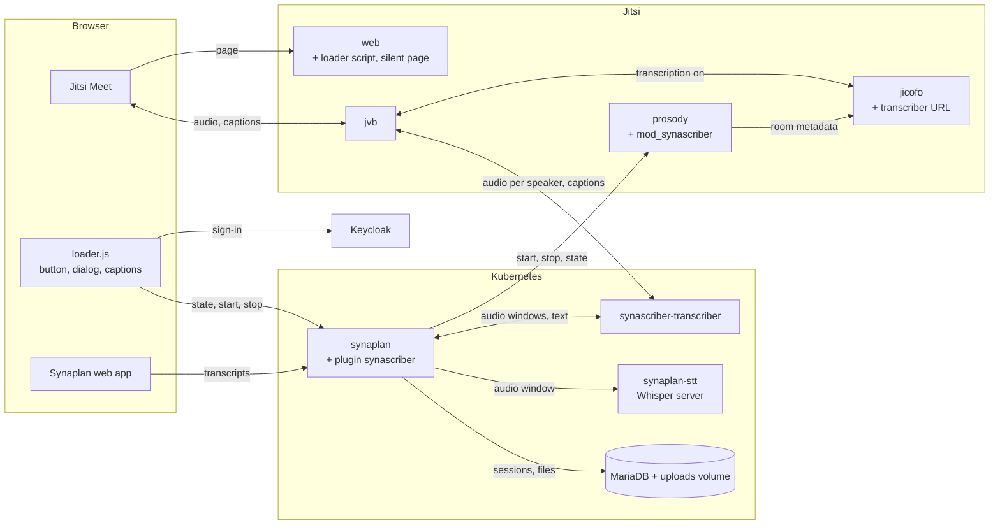

# 02 — Architecture

**Status:** current, 2026-10-15. Checked against the code of this repository,
[synaplan](https://github.com/metadist/synaplan),
[synaplan-stt](https://github.com/metadist/synaplan-stt) and
[synaplan-charts](https://github.com/metadist/synaplan-charts). It replaces
the plan of 2026-10-04
([02 at `6babe67`](https://github.com/metadist/synaScriber/blob/6babe67590475885bdb6a1e387c83e02ba9ff4a6/docs/02_architecture.md)),
which 00, 03, 04, 06 and 07 still describe. Where they differ, this file is
right.

---

## 1. Overview

Meeting notes is a Synaplan plugin. Jitsi's bridge streams each speaker's
audio to a small transcriber service. The transcriber sends short audio
windows to the plugin; the plugin gets the text from a Whisper server and
returns it as live captions. When the meeting stops, the plugin saves one
Markdown transcript per signed-in participant in Synaplan. Audio is never
stored.

Arrows point from the caller to the one called.

## 2. Repositories and packages

| Repository | Package | Runs in |
|------------|---------|---------|
| [synaScriber](https://github.com/metadist/synaScriber) (this one) | `synascriber-plugin/` 0.3.0: PHP backend, Jitsi loader `frontend/jitsi/loader.js`, plugin page `frontend/index.js` | the Synaplan pods, mounted at `/plugins/synascriber`; the loader runs in each participant's browser |
| | `prosody/mod_synascriber.lua` 0.3.0 | Jitsi's Prosody |
| | `jitsi/static/synascriber-silent.html` | Jitsi web |
| | `deploy/opendesk/chart`: Helm chart `synascriber` (transcriber, ConfigMaps, Secrets) | Kubernetes |
| | `deploy/opendesk/synascriber`: the installer for openDesk | the operator's machine |
| [synaplan](https://github.com/metadist/synaplan) | image `ghcr.io/metadist/synaplan` (installer pins 5.3.2; latest 5.4.1) | pods `synaplan`, `synaplan-worker`, `synaplan-scheduler` |
| | `sidecars/synaplan-transcriber` (Node 22; no published image) | pod `synascriber-transcriber`, built from source at `09d72d3` on pod start |
| [synaplan-stt](https://github.com/metadist/synaplan-stt) | image `ghcr.io/metadist/synaplan-stt:0.1.0-cpu` or `-cuda`: whisper.cpp, German Whisper large-v3-turbo, Silero VAD | pod `synaplan-stt` |
| [synaplan-charts](https://github.com/metadist/synaplan-charts) | charts `synaplan` 0.6.0 and `stt` 0.1.0; `deployments/opendesk-addon` with MariaDB 11.8 (pinned `a14fa65`, see §7) | Helm releases `synaplan-resources`, `synaplan`, `synaplan-stt` |
| Jitsi ([docker-jitsi-meet](https://github.com/jitsi/docker-jitsi-meet) images) | `jitsi/web`, `prosody`, `jicofo`, `jvb`; tested with `stable-11248` | your Jitsi deployment |

## 3. What you need to run it

| Piece | Requirement |
|-------|-------------|
| Kubernetes | One namespace for Synaplan and the transcriber. The installer needs `kubectl`, Helm 3 and helmfile. |
| Keycloak | Client `synaplan` (Synaplan sign-in) and public client `synascriber` (PKCE, the loader); both put `synaplan` in the token audience. |
| Jitsi | `stable-11031` or newer (bridge transcription), with token sign-in from the same Keycloak so Prosody knows each participant's `sub` and e-mail. Three additions: the loader script in `head.html` and the silent page in web; `mod_synascriber` with `SYNASCRIBER_SECRET` in Prosody; `transcription.url-template` with the bearer token in Jicofo. |
| Synaplan | 5.3.2 with MariaDB 11.7 or newer (VECTOR) and Redis, at `https://synaplan.<domain>`. The plugin is mounted in all Synaplan pods and installed for one administrator, the owner. The owner holds the transcriber's API key; the settings hold the Prosody URL and secret and the Whisper URL. |
| Speech-to-text | `synaplan-stt` on CPU (about 2× real time) or on a GPU (about 70×), or any whisper.cpp `whisper-server`. |
| Optional | Ollama for embeddings. Without it, transcripts are saved but chat cannot search them. |
| Network | Synaplan reaches Prosody on :5280 and Whisper on :8080; the bridge reaches the transcriber on :8095; the transcriber reaches Synaplan. At start, the transcriber pod downloads its source from `codeload.github.com` and `registry.npmjs.org`. |

On openDesk, `deploy/opendesk/synascriber install` sets up all of this; see
its [README](../deploy/opendesk/README.md).

## 4. How a meeting works

1. **Join.** Jitsi's `head.html` loads `loader.js` from Synaplan. The loader
   signs in to Keycloak in a hidden iframe (PKCE, `prompt=none`) and asks
   Synaplan every 15 s whether notes are on.
2. **Start.** The plugin stores a session with a random reference and calls
   Prosody. Prosody sets the room metadata; Jicofo tells the bridge to open
   a WebSocket to the transcriber with `notes=<reference>`.
3. **Speak.** The bridge sends each speaker's audio. The transcriber sends a
   preview every 1.5 s and a final window at a pause (0.7 s) or after 8 s.
   The plugin gets the text from the Whisper server and keeps the final
   text. The captions go back through the bridge to everyone.
4. **Stop.** The loader's Stop, a moderator's stop in Jitsi, or the last
   person leaving switches transcription off. The transcriber sends its last
   windows and `finished`. The plugin writes one Markdown file per signed-in
   participant into Synaplan › Sources › Generated.

## 5. Interfaces

| From → to | Call | Authentication |
|-----------|------|----------------|
| Browser → Synaplan | `GET /api/v1/user/<owner>/plugins/synascriber/assets/jitsi/loader.js` | none (public asset) |
| Loader → Keycloak | authorization code with PKCE, `prompt=none` | — |
| Loader → plugin | `GET …/jitsi/state?room=`, `POST …/jitsi/sessions`, `POST …/jitsi/sessions/{ref}/stop` | Keycloak bearer token |
| Plugin → Prosody | `GET /synascriber/health`, `GET /synascriber/state`, `POST /synascriber/start`, `POST /synascriber/stop` on :5280 | static bearer secret |
| Bridge → transcriber | WebSocket `:8095/transcribe?sessionId=…&notes=<ref>` | bearer transcriber token |
| Transcriber → plugin | `…/public/transcriber/sessions/{ref}` and `/audio`, `/preview`, `/events` | Synaplan API key of the owner |
| Plugin → Whisper | `POST /v1/audio/transcriptions` on :8080 | none; NetworkPolicy |
| Plugin page → plugin | `GET …/me/sessions`, `GET …/admin/status`, `PUT …/admin/settings` | Synaplan session |

`…` is `/api/v1/plugins/synascriber`.

## 6. What is stored where

| What | Where | How long |
|------|-------|----------|
| Audio | transcriber memory (at most 8 s per speaker) and one PHP temp file per request | seconds |
| Captions | messages through the bridge | not stored |
| Session, attendees (Keycloak `sub`, e-mail), text per window | MariaDB `plugin_data`, under the plugin owner | session kept; window text deleted after saving |
| Transcript, one copy per signed-in participant | Markdown file on the uploads volume, row in `BFILES`, vectors in `BRAG` (with Ollama) | until the person deletes it |
| Settings | `BCONFIG`, group `P_synascriber`; the Prosody secret in plain text | until changed |
| Secrets | Kubernetes Secret `synascriber` (`prosody-secret`, `transcriber-token`, `api-key`) | until uninstall |
| Browser | access token in memory; `localStorage` `synascriber.captions` | tab / permanent |

## 7. ToDo

1. **Fix the installer (blocking).** `defaults.yaml` pins synaplan-charts
   `a14fa65`, which a force-push removed; fresh installs fail. Pin a commit
   that exists, then follow the new layout of synaplan-charts#53. Until then:
   clone synaplan-charts, `git fetch origin a14fa65db007fd79d136d34f7457460e42553ae6 && git checkout FETCH_HEAD`,
   and set `SYNAPLAN_CHARTS_PATH` to that checkout. *synaScriber, synaplan-charts*
2. **Publish a transcriber image.** Stop downloading source code at pod
   start. *synaplan*
3. **Give the transcriber its own key.** Replace the owner's full-access API
   key with a limited token; this needs public plugin routes in Synaplan.
   *synaplan, synaScriber*
4. **Secure the Prosody calls.** Sign the requests (HMAC) and store the
   secret encrypted. *synaScriber*
5. **Check who starts.** Only people in the meeting may start notes; post a
   chat line on start and stop. *synaScriber*
6. **Test CPU and GPU speech-to-text** with the published `synaplan-stt`
   image. *synaScriber*
7. **Finish the session handling.** Switching the plugin off stops running
   notes; add a retention period for session records. *synaScriber*
8. **Add tests and tidy up.** Unit tests for the plugin routes and the
   Prosody module; update the route list in `manifest.json`. *synaScriber*
