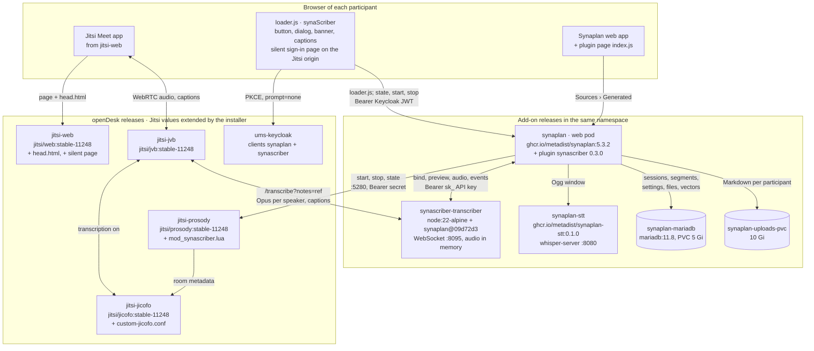
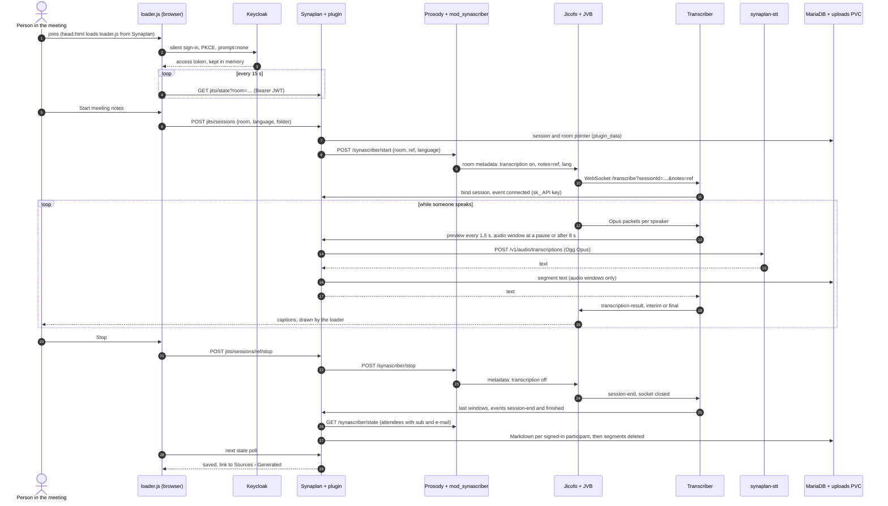

# 09 — As built (2026-10-14)

What runs once `deploy/opendesk/synascriber install` has added meeting notes
to an openDesk. Checked against this repository (`main` at `6babe67`),
[metadist/synaplan](https://github.com/metadist/synaplan) (`main` at
`60d883a`; latest release 5.4.1, the installer pins 5.3.2) and
[metadist/synaplan-charts](https://github.com/metadist/synaplan-charts)
(`main` at `33f2318`; the installer pins `a14fa65`).
[02](./02_architecture.md) is the plan of 2026-10-04; §6 lists where the
code differs from it.

---

## 1. Which description is current

| Document | State on 2026-10-14 |
|----------|---------------------|
| [`deploy/opendesk/README.md`](../deploy/opendesk/README.md) | Current, except two points: the `synaplan-stt` image is published now (`0.1.0-cpu`, `0.1.0-cuda`), and the pinned synaplan-charts commit no longer resolves (§7). |
| [`README.md`](../README.md), "How it works" | Current at its level of detail. |
| [`STATUS.md`](./STATUS.md) | Current up to 2026-10-12, plus the entry of 2026-10-14. |
| [`02_architecture.md`](./02_architecture.md), [`00_master_plan.md`](./00_master_plan.md) §4–§6 | The plan. Many interfaces differ from the code (§6). |
| [`03_plugin.md`](./03_plugin.md) | The plan. Repository layout, classes, routes and settings differ. |
| [`04_jitsi_and_opendesk.md`](./04_jitsi_and_opendesk.md) | Partly: the Keycloak client and the dialog match; the loader include, the Prosody API, the Jicofo variable names and the chat lines do not. |
| [`06_dev_environment.md`](./06_dev_environment.md) | Superseded by the installer for openDesk. |
| [`08_stt_service.md`](./08_stt_service.md) | Status line updated on 2026-10-14; §2 still lists files that moved to `metadist/synaplan-stt`. |
| [`synascriber-plugin/manifest.json`](../synascriber-plugin/manifest.json) `routes` | Still names `…/transcriber/sessions/{ref}/finish`; misses `public/`, `preview` and `events`. |

## 2. Picture

Arrows point from the caller to the one called. `jitsi-` stands for the
name of openDesk's Jitsi release. Everything runs in openDesk's namespace.

One meeting from join to saved file:

A moderator's stop in Jitsi, or the last person leaving, enters this flow at
step 24: the bridge ends the socket. If `finished` never arrives, the first
read of the session 60 s or more after the stop saves it (a loader poll or
the personal page); there is no timer.

## 3. Pods and images

| Release (source) | Pod | Image | Job |
|------------------|-----|-------|-----|
| openDesk `jitsi` (chart opendesk-jitsi 3.12.4; values extended by the installer with `helm upgrade`, same chart version) | `jitsi-web` | `jitsi/web:stable-11248` | Jitsi Meet; plus `head.html` (script tag for the loader) and `static/synascriber-silent.html`. |
| | `jitsi-prosody` (StatefulSet) | `jitsi/prosody:stable-11248` | XMPP and rooms; plus `mod_synascriber.lua` from ConfigMap `synascriber-prosody`, `XMPP_MODULES=synascriber`, `SYNASCRIBER_SECRET` from Secret `synascriber-prosody`, HTTP on :5280. |
| | `jitsi-jicofo` | `jitsi/jicofo:stable-11248` | Conference focus; plus `custom-jicofo.conf` with the transcriber URL and `${?SYNASCRIBER_TRANSCRIBER_TOKEN}` from Secret `synascriber-jicofo`. |
| | `jitsi-jvb` | `jitsi/jvb:stable-11248` | Bridge, unchanged; opens the WebSocket to the transcriber. |
| | `jitsi-jitsi-keycloak-adapter` | `nordeck/jitsi-keycloak-adapter` | Signs people in to Jitsi; its token carries Keycloak `sub` and e-mail, which Prosody reads for the attendee list. |
| openDesk platform | `ums-keycloak` | openDesk's | Clients `synaplan` (confidential, Synaplan sign-in) and `synascriber` (public, PKCE, the loader). |
| | `ums-udm-rest-api` | openDesk's | Portal tile `synaplan`. |
| `synaplan-resources` (synaplan-charts `deployments/opendesk-addon` at `a14fa65`) | `synaplan-mariadb` (StatefulSet) | `docker.io/library/mariadb:11.8` | Synaplan's database on PVC `data-synaplan-mariadb-0` (5 Gi). The release also creates the Secrets `synaplan-mariadb`, `synaplan-oidc-credentials`, `synaplan-app-secret` and `synaplan-bootstrap-admin`. |
| `synaplan` (synaplan-charts `charts/synaplan` 0.6.0 at `a14fa65`) | `synaplan` | `ghcr.io/metadist/synaplan:5.3.2` | FrankenPHP (Caddy and PHP) with the Vue app on :80, Ingress `synaplan.<domain>`. Runs the plugin from `/plugins/synascriber` (ConfigMap `synascriber-plugin`, read-only) and keeps uploads on `synaplan-uploads-pvc` (10 Gi). |
| | `synaplan-worker`, `synaplan-scheduler` | same image, `SYNAPLAN_ROLE=worker` / `scheduler` | Background jobs; same mounts, not used by meeting notes. |
| | `synaplan-redis` | `redis:8.10-alpine` | Cache, queues and locks on an `emptyDir`. |
| `synaplan-stt` (synaplan-charts `charts/stt` 0.1.0; only with `STT=cpu` or `gpu`) | `synaplan-stt` | `ghcr.io/metadist/synaplan-stt:0.1.0-cpu` or `-cuda` | whisper.cpp `whisper-server` on :8080 with the German large-v3-turbo (q8_0) and Silero VAD. Its NetworkPolicy admits only the synaplan pods. `STT=url` uses a server you run instead. |
| `synascriber` (this repository, `deploy/opendesk/chart` 0.1.0) | `synascriber-transcriber` | `docker.io/library/node:22-alpine` (pinned by digest) | The init container downloads `metadist/synaplan` at `09d72d3` from `codeload.github.com` and runs `npm ci` against `registry.npmjs.org`; the container runs `sidecars/synaplan-transcriber` with `TRANSCRIBER_MODE=jitsi`, WebSocket and `/health` on :8095. |

The installer itself runs on the operator's machine: `./synascriber`
(Python, standard library) drives helmfile, uses `kubectl exec` into the
synaplan pod (plugin install, API key, settings), reaches the Keycloak admin
API and openDesk's directory through port-forwards, and keeps its state in
`~/.local/state/synascriber/<context>/<namespace>/`.

## 4. The JavaScript

| File | Runs in | Served from | Keeps |
|------|---------|-------------|-------|
| `synascriber-plugin/frontend/jitsi/loader.js` (plain JavaScript, no build step) | the Jitsi tab of every participant | Synaplan's public plugin asset route `GET /api/v1/user/<owner id>/plugins/synascriber/assets/jitsi/loader.js`; the file is reached through a symlink from the plugin owner's upload folder to `/plugins/synascriber/frontend` | the Keycloak access token in memory; `localStorage` key `synascriber.captions` on the Jitsi origin |
| `jitsi/static/synascriber-silent.html` | a hidden iframe (or a popup) on the Jitsi origin | `jitsi-web` (`web.extraFiles`) | nothing; posts Keycloak's `code` to the loader |
| `synascriber-plugin/frontend/index.js` | Synaplan's web app, Plugins › Meeting notes | the asset route of the person viewing it (installed for every verified user) | nothing; uses the Synaplan cookie session |
| `sidecars/synaplan-transcriber/src/*.js` (Node 22, `ws`) | pod `synascriber-transcriber` | the source tarball fetched at pod start | audio windows in memory only; read-only root file system |

## 5. What is stored where

| What | Where | How long |
|------|-------|----------|
| Audio | transcriber memory (one window per speaker, at most 8 s, plus previews); PHP's upload temp file for one request | seconds; never on a volume |
| Live captions | `transcription-result` messages from the transcriber through the bridge to every participant | not stored |
| Session: state, room, starter, language, folder, roster, attendees (Keycloak `sub`, e-mail, name), file ids | MariaDB `plugin_data`, plugin `synascriber`, row owner = the plugin owner, type `session`, key `s_<sha256(ref)>` | kept; no retention yet |
| Room pointer | `plugin_data` type `room`, key `r_<sha256(room)>` | until the session ends |
| Recognised text per window | `plugin_data` type `seg_<sha256(ref)>` | deleted once the transcript is saved |
| Transcript: one Markdown copy per signed-in participant | file on `synaplan-uploads-pvc` in the person's upload folder; row in `BFILES` (source `generated`, kind `document`, the chosen folder, source id `synascriber-<ref>`) with the extracted text | until the person deletes it |
| Search vectors of the transcript | MariaDB `BRAG` (VECTOR); only with an embedding model (`OLLAMA_URL`) | with the file |
| Settings | `BCONFIG` owner 0, group `P_synascriber`; `prosody_secret` in plain text | until changed |
| The transcriber's API key | `BAPIKEYS` (owner = the plugin owner, empty scope list = full access) and Secret `synascriber`, key `api-key` | until uninstall |
| Shared secrets | Secret `synascriber` (`prosody-secret`, `transcriber-token`, `api-key`; kept on upgrades), copied as environment into `synascriber-prosody` and `synascriber-jicofo` | until uninstall |
| Meeting state in Jitsi | Prosody memory: room metadata (`asyncTranscription`, `recording.isTranscribingEnabled`, `transcription.urlParams` with `notes=<ref>` and `lang`), the ref, the attendees | while the room exists |
| Accounts | `BUSER`; created at the first call with a Keycloak bearer token, or by the plugin for attendees who never opened Synaplan | — |

## 6. Plan and code side by side

| Topic | Plan ([02](./02_architecture.md), [00](./00_master_plan.md) §4, [04](./04_jitsi_and_opendesk.md)) | Code on 2026-10-14 |
|-------|------|------|
| Loader delivery | `GET …/public/jitsi/loader.js` and `…/public/jitsi/config` | core asset route of the plugin owner; Synaplan URL, issuer and client id as `data-*` attributes of the `head.html` script tag |
| Loader | TypeScript bundle, closed Shadow DOM | plain JavaScript, open Shadow DOM |
| Jitsi include | one line in `custom-config.js` | `head.html` through `web.extraFiles` |
| Loader API | `jitsi/me`, `GET jitsi/sessions/{id}` | `GET jitsi/state?room=` every 15 s, `POST jitsi/sessions`, `POST jitsi/sessions/{ref}/stop` |
| Plugin → Prosody | HMAC with time and nonce, `/synaplan-notes/v1/*` | `Authorization: Bearer <prosody-secret>`, `/synascriber/{health,state,start,stop}` |
| Prosody → plugin | callbacks `roster`, `transcription-stopped`, `room-destroyed` | none; the plugin reads `GET /synascriber/state`, Prosody remembers the attendees |
| Checks at start | Prosody: starter is in the room, meeting id is live, no E2EE; a chat line for everyone | none of these and no chat line; only "already on" (409) |
| Transcriber → plugin | own transcriber token, no API key in the transcriber | Synaplan API key `sk_…` of the plugin owner (Synaplan's local administrator); the empty scope list means full access |
| Speech-to-text | `AiFacade::transcribe` as the starter (model choice, metering) | the plugin's `WhisperClient` posts to its `stt_url` directly; no metering per person |
| States | `starting`, `running`, `paused`, `stopping`, `saved`, `saved_with_gaps`, `nothing_to_save`, `failed` | `starting`, `running` (as soon as Prosody accepted), `stopping`, `saving`, `saved`, `nothing_to_save`, `failed`; gaps are counted and named in the file |
| Watchdog | scheduler task every 60 s, 30 s to connect | runs on every read of a session, 45 s to connect, 60 s after stop |
| Data model | rows under the starter; `session`, `session_ref`, `segment`, `room_lock`; audit in `BAUDITLOG` | rows under the plugin owner; `session`, `room`, `seg_<hash>`; log lines, no audit events |
| Secrets in Synaplan | encrypted with `EncryptionService` | plain text in `BCONFIG` |
| Admin page | four status lines, Connect openDesk, Stop all, session list | status (Jitsi, speech, owner, secret) and settings; switching off hides the button but does not stop running sessions |
| Synaplan version | 5.2.0 with `MN-1` and `MN-8a` | 5.3.2 without them (`minSynaplanVersion` 5.1.3) |
| Transcriber image | published `synaplan-transcriber` image | source tarball and `npm ci` at pod start |
| Live captions | Jitsi's subtitles (`config.transcription`) | the loader's own caption strip from `transcription-result`; long windows are cut at phrase ends from the preview's `segmentEndsMs` |
| Metrics | `/metrics` | `/health` only |

Four of these change what the plan promised and need a decision rather
than a doc fix: the transcriber's full-access API key, the static Prosody
secret instead of HMAC, the missing "starter is in the room" check, and the
plain-text secret in `BCONFIG`.

## 7. Upstream state (2026-10-14)

- **The installer's synaplan-charts pin does not resolve.**
  [`defaults.yaml`](../deploy/opendesk/defaults.yaml) pins `a14fa65`, a
  commit of [synaplan-charts#53](https://github.com/metadist/synaplan-charts/pull/53)
  that a force-push removed from every branch. helmfile clones the
  repository and checks the commit out, which fails with
  `reference is not a tree` (reproduced with helmfile 1.1.7 and an empty
  cache). `install`, `plan` and `uninstall` stop at the Helm step on every
  machine without a cached copy. Until the pin moves: clone synaplan-charts,
  run `git fetch origin a14fa65db007fd79d136d34f7457460e42553ae6 && git checkout FETCH_HEAD`,
  and set `SYNAPLAN_CHARTS_PATH` to that checkout.
- **synaplan-charts#53 changes the layout.** The branch no longer has
  `deployments/opendesk-addon`; it lays the deployment out like openDesk
  (`helmfile/apps/synaplan` with the releases `synaplan`, `synaplan-stt` and
  `synaplan-mariadb` from openDesk's MariaDB chart, the Secret
  `synaplan-credentials`, the switch `technical.synaplan.sovereign`). The
  installer's release and Secret names have to follow once it merges.
- **The speech-to-text image is published.**
  [synaplan-charts#51](https://github.com/metadist/synaplan-charts/pull/51)
  merged on 2026-10-13. The image is built in
  [metadist/synaplan-stt](https://github.com/metadist/synaplan-stt) (tag
  `v0.1.0`) and published as `0.1.0-cpu` and `0.1.0-cuda`. The `stt` chart is
  on synaplan-charts `main` with VAD on by default; as an OCI chart it exists
  only as `0.0.0-dev.*`. `deployments/synaplan-with-triton` is now
  `deployments/synaplan-standalone`
  ([#64](https://github.com/metadist/synaplan-charts/pull/64)).
- **Synaplan has no Whisper server mode.** `backend/` on `main` does not read
  `WHISPER_SERVER_URL`; `WhisperService` runs the whisper.cpp binary. The
  chart value `speech.whisperServerUrl` has no effect, and meeting notes
  reach `synaplan-stt` only through the plugin's own `stt_url`.
- **Synaplan has no public plugin routes.** `security.yaml` on `main` has no
  rule for `^/api/v1/plugins/[^/]+/public/`, so `…/public/transcriber/*`
  needs a signed-in caller, hence the API key in §6.
- **Transcriber.** `sidecars/synaplan-transcriber` on `main` is unchanged
  since the pinned `09d72d3`. Synaplan's CI builds its image only to run the
  tests; it is not published.
- **Core module.** Synaplan's own `opendesk_stt` module (`OPENDESK_STT_URL`)
  still exists next to the plugin; the installer leaves it off.
